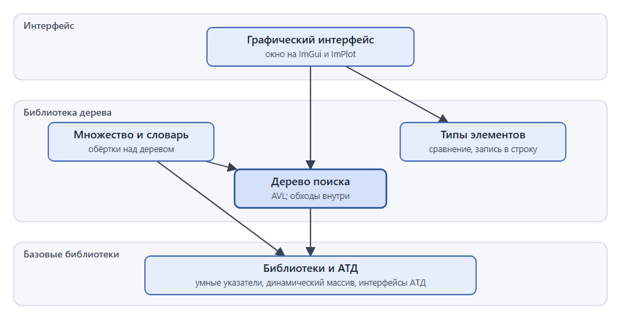

# Дизайн: ЛР-1 «AVL-дерево»

## 1. Постановка задачи

### 1.1. Что делается

АТД «упорядоченное множество» и «словарь» на основе самобалансирующегося бинарного дерева поиска (AVL).
Графический интерфейс для удобной работы со структурами данных (в частности с деревом, подробнее см.
функциональные требования), вкладка с замерами и легко читаемыми графиками сравнения эффективности.

Дерево работает с любым типом элементов: от ключа нужно только сравнение «меньше», от значения — ничего,
кроме возможности поместить его в дерево. Для примера в интерфейсе подключены целые и вещественные числа,
строки, комплексные числа, студенты и преподаватели.

### 1.2. Зачем это нужно

Для задач хранения меняющегося набора ключей, когда нужны быстрый поиск и перебор по порядку:

- индексы в базах данных и файловых системах;
- словари и таблицы символов;
- очереди по приоритету.

В дальнейшем в ЛР-2 на дереве построен индекс файлов.

## 2. Сущности прикладной задачи

| Понятие | Описание |
|---|---|
| Множество | Упорядоченный набор уникальных ключей. |
| Словарь | Набор пар «ключ — значение» с уникальными ключами. |

Дерево и узлы — части общего, библиотечного решения, а не прикладной задачи. Они описаны в
разделе 3.3.

## 3. Архитектура

### 3.1. Компоненты

| Компонент | Слой | Назначение |
|---|---|---|
| Графический интерфейс | интерфейс | Окно на ImGui и ImPlot: работа с деревом вручную, его отрисовка, запуск замеров и графики |
| Дерево поиска | библиотека дерева | Все операции над деревом: изменение, поиск, обходы, преобразования, поддеревья, строки. Обходы — подсистема внутри дерева |
| Множество и словарь | библиотека дерева | Тонкие обёртки над деревом с интерфейсами множества и словаря |
| Типы элементов | библиотека дерева | Типы-примеры для интерфейса: сравнение, запись в строку и чтение из строки |
| Библиотеки и АТД | базовые библиотеки (свои) | Умные указатели, динамический массив, интерфейсы коллекции, перечислителя, множества и словаря |

### 3.2. Связи между компонентами

Каждая стрелка означает «использует». Зависимости направлены сверху вниз: интерфейс обращается к
библиотеке дерева, она — к базовым библиотекам. Библиотека ничего не знает об интерфейсе. Дерево не
знает ни о множестве и словаре, ни о типах элементов: множество и словарь построены поверх дерева,
а типы подставляются в дерево параметром.

Модульные тесты и замеры производительности на схеме не показаны: это способы проверить систему, а не
её части.

### 3.3. Описание компонентов, алгоритмов и решений

#### Дерево поиска

Структура данных — AVL-дерево, вставка, удаление и балансировка стандартные. Дерево параметризовано
типом ключа и, необязательно, типом значения: без значения это множество, со значением — словарь. Все
сравнения идут по ключу, который дерево достаёт из элемента: у множества элемент и есть ключ, у словаря
ключ — первая часть пары.

**Что нужно от типов.**

| Тип | Что должен уметь | Для чего |
|---|---|---|
| Ключ | Сравнение «меньше» со строгим порядком | Все операции. Ключи равны, если ни один не меньше другого, поэтому отдельное «равно» не нужно |
| Ключ, значение | Перемещение | Добавление: элемент переходит в узел без копии |
| Элемент | Копирование | Только операциям, которые по смыслу создают копии: копия дерева, where, извлечение поддерева, поиск с копией результата, выгрузка в массив |
| Элемент | Перевод в строку и обратно | Только записи в строку и чтению из строки |

Больше дереву ничего не нужно: значением может быть некопируемый объект, объект без значения по
умолчанию или функция. Если тип чего-то не умеет, недоступны только операции, которым это нужно.

**Поведение в особых случаях.**

| Ситуация | Поведение |
|---|---|
| Добавить ключ, который уже есть | Дерево и множество не меняются и сообщают, что элемент не добавлен. Словарь сообщает об ошибке, старое значение остаётся |
| Удалить отсутствующий ключ | Дерево и множество не меняются и сообщают, что удалять нечего. Словарь сообщает об ошибке |
| Прочитать отсутствующий ключ | Ошибка. Безопасный поиск возвращает пустой результат |
| Номер элемента вне диапазона | Ошибка |
| Извлечь поддерево с отсутствующим корнем | Ошибка |
| Пустое дерево | Обходы ничего не выдают, свёртка возвращает начальное значение, запись в строку — пустая строка |
| map дал одинаковые ключи | В новом дереве остаётся один элемент |
| Дерево изменилось во время перебора | Следующий шаг перебора сообщает об ошибке. Неудачное добавление и удаление дерево не меняют и перебор не прерывают |
| Строка с ошибкой | Ошибка с позицией. Отклоняются и строки, которые не описывают дерево поиска, и вложенность глубже 1000 уровней |

**Сложность.**

| Операция | Сложность |
|---|---|
| Добавление, удаление, поиск, элемент по номеру, номер элемента | O(log n) |
| Перебор в глубину в любом порядке | O(n), память O(log n) |
| Перебор по уровням | O(n), память O(n) |
| map | O(n log n) |
| where, reduce, сравнение деревьев, запись в строку и чтение | O(n) |
| Извлечение поддерева, поиск вхождения поддерева | O(log n + m), m — размер поддерева |

Решения:

- **Владение узлами.** Дерево держит корень, каждый узел держит детей через `ShrdPtr`.
- **Защита перебора.** Дерево держит у себя метку поколения, перечислитель — невладеющую ссылку на
  неё. Любое изменение дерева выбрасывает метку, а уничтожение или присваивание дерева уничтожают её
  вместе со старыми узлами. На каждом шаге перечислитель проверяет, жива ли его метка; если нет —
  сообщает об ошибке. Сравнивать версии не нужно: «дерево изменилось» значит ровно «метки больше нет».
  Метка создаётся при выдаче перечислителя, поэтому изменения без перебора ничего не стоят. Сам перебор
  удерживает узлы, по которым идёт, поэтому даже при ошибке в вызывающем коде не читает освобождённую
  память.
- **Один механизм обходов.** Обход — стратегия, которую дерево получает параметром, одинаково в
  переборе, свёртке, выгрузке в массив. Шесть порядков КЛП…ПКЛ — одна стратегия «в
  глубину» с порядком частей как аргументом. Обход по уровням и свои обходы, например только правая
  ветвь или только листья, подключаются так же, без изменения дерева. Даже выбор обхода из списка в
  интерфейсе — тоже стратегия, собранная из готовых. Стратегия видит узлы только для чтения и не может
  нарушить порядок и баланс. Обход в глубину использует явный стек не глубже высоты
  дерева, поэтому при 10⁸ элементах стек вызовов не переполняется.
- **Доступ по номеру.** Каждый узел хранит размер своего поддерева, поэтому элемент по номеру и номер
  элемента находятся спуском за O(log n).
- **where без вставок.** Подходящие элементы собираются в порядке возрастания, и из них сразу строится
  сбалансированное дерево. Так же перестраивается корректное, но несбалансированное дерево из строки,
  причём из тех же узлов, без копирования элементов.
- **Поиск вхождения поддерева.** В дереве поиска корень искомого поддерева однозначно находится
  поиском, после этого сравниваются форма и ключи.
- **Формат записи.** Формат задаётся строкой, например `{К}(Л)[П]`: из неё берутся порядок частей и
  ограничители. Символы, совпадающие с ограничителями, экранируются через `\`. Неоднозначные форматы
  отклоняются ещё до разбора: неоднозначным считается формат, где ограничитель после поддерева
  начинается с того же символа, что и открывающий.
- **AVL, а не красно-чёрное дерево.** Баланс у AVL строже: высота не больше 1,44·log₂ n. Поиск и
  обходы от этого быстрее, а в работе их больше, чем изменений.
- **Множество и словарь на одном дереве.** Дерево хранит элемент, а сравнивает только ключ. Так же
  устроены стандартные упорядоченные множество и словарь. Поэтому поиск в словаре идёт по самому
  ключу, без пары-образца с пустым значением, и значению не нужно значение по умолчанию.

#### Типы элементов

Для каждого типа-примера заданы сравнение и перевод в строку и обратно. Дерево о них не знает, поэтому
новый тип подключается без изменения дерева. Комплексные числа сравниваются по модулю, при равном модуле —
по действительной и мнимой частям, люди — по идентификатору; ФИО и прочие поля в сравнении не участвуют.

#### Графический интерфейс

- Дерево рисуется по координатам: по горизонтали — номер элемента в порядке возрастания, по вертикали —
  глубина узла. Поэтому узлы не накладываются друг на друга при любой форме дерева.
- Ошибки операций, например неверная строка или отсутствующий элемент, выводятся в журнал и не
  прерывают работу.
- Замеры идут в фоновом потоке, их можно отменить. Результаты сохраняются в CSV, окно может загрузить
  файл, посчитанный консольной программой.

#### Библиотеки и АТД

Свои реализации: умные указатели, динамический массив, интерфейсы коллекции, перечислителя, множества
и словаря.

## 4. Функциональные требования

**К дереву**

- Добавить элемент. Если такой ключ уже есть, дерево не меняется.
- Найти элемент; удалить элемент. Удаление отсутствующего элемента дерево не меняет. После любого
  изменения дерево остаётся сбалансированным.
- Получить элемент по номеру в порядке возрастания и номер элемента. Номер вне диапазона выдаёт ошибку.
- Добавить и удалить элемент операторами `+=` и `-=`, обратиться к элементу по номеру через `[]`,
  сравнить два дерева как множества (`==`, `!=`).
- Построить новое дерево через map и where, свернуть дерево через reduce в любом порядке обхода.
- Извлечь поддерево с корнем в заданном элементе; если элемента нет, выдаёт ошибку. Проверить, входит
  ли другое дерево в данное как поддерево с той же формой.

**К обходам**

- Перебрать элементы в любом порядке обхода: в глубину в любом из 6 порядков, по уровням или своей
  стратегией — одним механизмом, не меняя дерево. Если дерево изменилось во время перебора, перебор
  сообщает об ошибке.

**К множеству и словарю**

- Множество: добавить ключ (повтор не добавляется), удалить, проверить наличие, перебрать по
  возрастанию.
- Словарь: добавить пару (повтор ключа — ошибка), получить и изменить значение по ключу, удалить по
  ключу (отсутствующий ключ — ошибка), перебрать пары по возрастанию ключей.

**К строковой записи**

- Задать формат: порядок частей и ограничители. Неоднозначный формат отклоняется.
- Записать дерево в строку по формату и прочитать дерево из строки.
- При чтении отклоняются:
  - строка с синтаксической ошибкой — с указанием позиции;
  - строка, которая не описывает дерево поиска;
  - вложенность глубже 1000 уровней.

  Корректное, но несбалансированное дерево перестраивается.

**К типам элементов**

- Ключом может быть любой тип со сравнением «меньше», значением — любой тип, который можно переместить в
  дерево. Копирование и перевод в строку нужны только операциям, которые ими пользуются.
- В интерфейсе доступны целые и вещественные числа, строки, комплексные числа, студенты и
  преподаватели. Для каждого определены сравнение, запись в строку и чтение из строки.

**К замерам**

- Замерить вставку, поиск, обход, запись и чтение строки, удаление для n от 10³ до 10⁸. Сравнить с
  эталонным множеством на тех же ключах и замерить память дерева.
- Параметры прогона задаются пользователем:
  - максимальное n;
  - число шагов на порядок;
  - начальное значение генератора;
  - отключение эталона;
  - предел n для строковых операций;
  - файл результата.
- Сохранить результаты в CSV и загрузить их обратно.

**К интерфейсу**

- Выбрать тип элементов. Ввести элементы вручную или заполнить дерево автоматически: задаются
  количество, диапазон и начальное значение генератора.
- Показать дерево. Щелчок по узлу подставляет его значение в поле ввода, Ctrl + колесо меняет масштаб.
  Можно показать любой из 6 обходов, обход по уровням.
- Выполнить из интерфейса map, where, reduce, операции с поддеревьями, запись и чтение строки. Все
  операции и ошибки попадают в журнал.
- Запустить замеры в фоне, отменить их, посмотреть графики общего времени и времени на один элемент,
  таблицу результатов.

**К системе в целом**

- Все операции работают одинаково для любого типа элементов.
- Некорректные входные данные не роняют программу: функции сообщают об ошибке исключением, интерфейс
  показывает её в журнале.
- Память не утекает при любых последовательностях операций, включая ошибочные.
- Основные алгоритмы покрыты модульными тестами. Среди них:
  - случайные операции, сверенные с эталонным множеством;
  - все 6 обходов, обход по уровням и свои стратегии обхода — в переборе, свёртке;
  - ключи и значения без копирования и без значения по умолчанию, функции в роли значений;
  - множество и словарь;
  - разбор строк с ошибками;
  - перебор после изменения, присваивания и уничтожения дерева.
