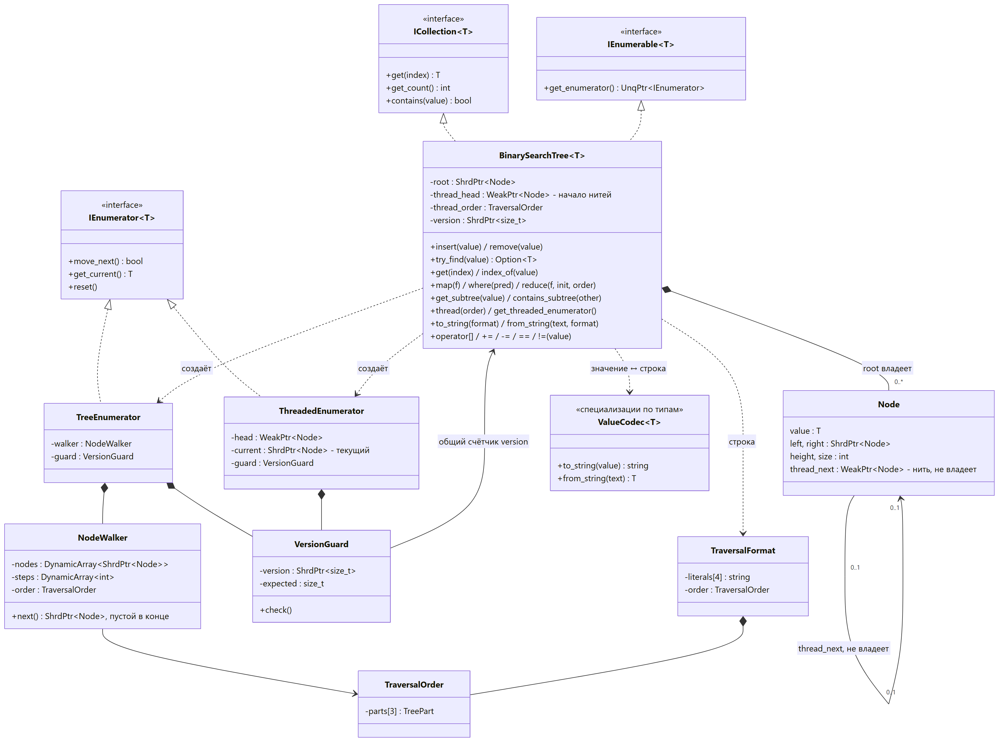
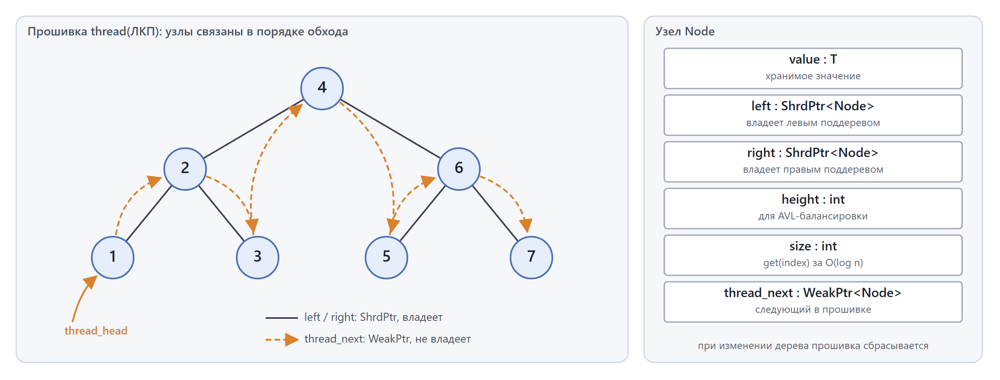
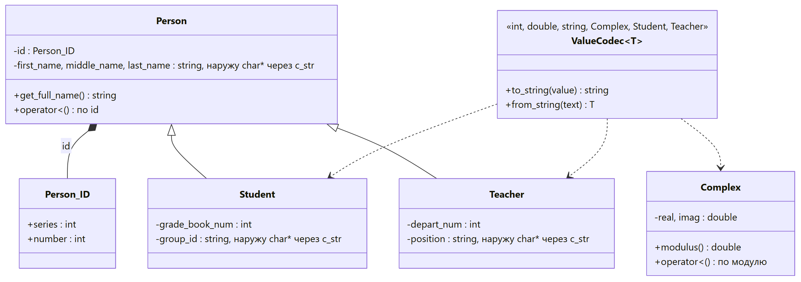
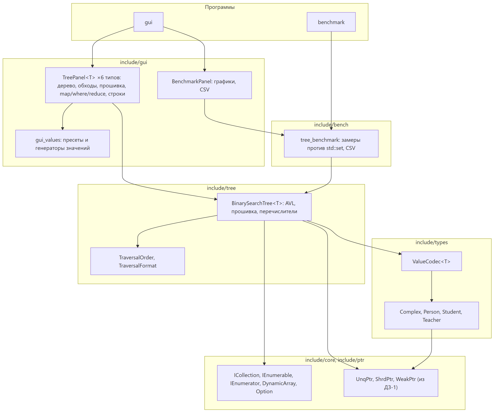

# ТЗ: ЛР-1 «AVL-дерево поиска»

Шаблон `BinarySearchTree<K, V>`: сбалансированное (AVL) прошитое дерево поиска на своих умных указателях из ДЗ-1.
Без `V` это множество ключей, с `V` — словарь; на нём построены `ISet` и `IDictionary`.
К нему прилагаются GUI для ручной работы с деревом и бенчмарк, который сравнивает дерево с `std::set`.

| Пункт | Что сделано | Баллы |
|---|---|---|
| 1 / 1.1 | Вставка, поиск, удаление; AVL-балансировка | 5 + 2 |
| 1.2 | `map`, `where`, `reduce` (reduce в любом из 6 обходов) | 3 |
| 1.3.2 | Прошивка по обходу, заданному параметром | 4 |
| 1.4.2 / 1.5.2 | Запись в строку и чтение из строки по формату `{К}(Л)[П]` | 3 + 4 |
| 1.6 / 1.7 | Извлечение поддерева, поиск вхождения поддерева | 2 + 3 |
| 7.1 – 7.3 | `ICollection`, `IEnumerable` + перечислитель, операторы `[] += -= == !=` | 7 |
| | **Итого** | **33** |

## 1. Сущности и связи

| Сущность | Что это |
|---|---|
| `BinarySearchTree<K, V>` | Дерево: владеет корнем, хранит голову прошивки, обход, которым прошито, и метку поколения. Ищет и сортирует только по ключу `K`; от `K` нужен только `operator<`, от `V` — только перемещение |
| `TreeEntry<K, V>` | Что лежит в узле: у множества (`V` не указан) сам ключ, у словаря пара `KeyValue<K, V>` |
| `Node` | Узел: элемент, два владеющих указателя на детей, высота, размер поддерева, нить |
| `TreeSet<K>`, `TreeDictionary<K, V>` | Множество и словарь: тонкие обёртки над деревом, реализуют `ISet` и `IDictionary` |
| `TraversalEnumerator<Traversal>` | Перечислитель по любой стратегии обхода: один механизм и для 6 порядков, и для остальных обходов |
| `ReadOnlyNode` | Узел только для чтения (`value`, `left`, `right`, `height`): через него стратегия видит дерево |
| `DepthFirst`, `LevelOrder` | Готовые стратегии-объекты: в глубину в любом из 6 порядков (порядок — параметр стратегии, свой стек) и по уровням. Перебор — их вложенный `Walk<Node>` |
| `ThreadedEnumerator` | Перебор прошитого дерева по нитям, O(1) дополнительной памяти |
| `Generation` | Метка поколения: дерево выбрасывает её при каждом изменении, перечислитель видит это через `WeakPtr` |
| `TraversalOrder` | Порядок обхода: перестановка частей К, Л, П (6 вариантов) |
| `TraversalFormat` | Формат строки: порядок обхода и 4 ограничителя, например `{К}(Л)[П]` |
| `ValueCodec<T>` | Перевод значения в строку и обратно. Нужен только записи в строку: числа и строки в `core`, типы-примеры в `types` |
| `ICollection`, `IEnumerable`, `IEnumerator` | Интерфейсы коллекции из задания 7 |
| `ISet<K>`, `IDictionary<K, V>` | Множество (`add`, `remove`, `contains`) и словарь (`add`, `get`, `remove`, `contains_key`) |

| Связь | Вид | Смысл |
|---|---|---|
| Дерево → корень, узел → дети | композиция (`ShrdPtr`) | Узлом владеет только родитель, поэтому при удалении поддерево освобождается само, без утечек и двойного удаления. Обход и перечислители держат копии `ShrdPtr` и не могут прочитать удалённый узел |
| Узел → `thread_next` | ассоциация (`WeakPtr`) | Нить только указывает на узел и не владеет им, иначе владение зациклилось бы. Сырых указателей на узлы нет |
| Дерево → метка поколения ← перечислитель | `ShrdPtr` у дерева, `WeakPtr` у перечислителя | Меткой владеет только дерево и заменяет её при изменении; уничтожение и присваивание дерева убирают её сами. Перечислитель без метки бросает исключение и не идёт по старым узлам |
| Дерево → `ICollection`, `IEnumerable` | реализация | Дерево можно передавать везде, где ожидается коллекция |

Типы элементов. Порядок задаётся через `operator<`: `Complex` сравнивается по модулю, `Person` по `id`.

Модули: стрелка означает «использует».

## 2. Функциональные требования

**Дерево**
- ФТ-1. Вставка, поиск, удаление за O(log n) с AVL-балансировкой; повторная вставка не меняет дерево.
- ФТ-2. `get(index)`, `operator[]`, `index_of` выдают элемент по позиции в порядке возрастания и позицию элемента.
- ФТ-3. `map(f)` строит новое дерево: значения, совпавшие после преобразования, схлопываются в одно.
  `where(pred)` строит дерево из подходящих элементов. `reduce(f, init, обход)` сворачивает элементы в любом обходе.
- ФТ-4. `thread(обход)` прошивает дерево по заданному обходу, перебор затем идёт по нитям.
  Прошивка — свойство дерева: после вставок и удалений нити перешиваются тем же обходом перед перебором по ним.
- ФТ-5. `to_string(format)` и `from_string(text, format)` работают в формате, заданном строкой:
  порядок частей и ограничители, `\` для экранирования. Корректное, но несбалансированное BST при чтении перестраивается.
- ФТ-6. `get_subtree(value)` копирует поддерево с корнем `value`.
  `contains_subtree(other)` проверяет, входит ли `other` в дерево как поддерево с той же структурой.
- ФТ-7. Перечислители по любому обходу и по нитям; операторы `+= -= == !=`. Два дерева равны, если совпадают как множества.
  Обход задаётся одним механизмом — объектом-стратегией, одним и тем же параметром в `get_enumerator`, `reduce`,
  `to_array`, `thread`: `tree.reduce(f, 0, DepthFirst("КЛП"))`, `tree.reduce(f, 0, LevelOrder())`.
  6 порядков — одна стратегия `DepthFirst` со своим параметром. Своя стратегия — класс с вложенным шаблоном
  `Walk<Node>` (конструктор от корня и стратегии, метод `next()`), подставляется так же.
- ФТ-8. Типы элементов: `int`, `double`, `std::string`, `Complex`, `Student`, `Teacher`.
- ФТ-8а. Одно дерево служит и множеством, и словарём: `BinarySearchTree<K>` хранит ключи,
  `BinarySearchTree<K, V>` — пары ключ-значение. Поиск, удаление и позиция идут по ключу,
  значение в сравнениях не участвует и меняется прямо в дереве. `TreeSet<K>` реализует `ISet<K>`,
  `TreeDictionary<K, V>` — `IDictionary<K, V>`; значению словаря не нужны ни конструктор по умолчанию, ни копирование.

**GUI**
- ФТ-9. Выбор типа элементов. Ручной ввод и автозаполнение: количество, диапазон, seed.
- ФТ-10. Дерево рисуется на экране: щелчок по узлу подставляет значение в поле ввода, Ctrl + колесо меняет масштаб.
  Можно показать 6 обходов и нити прошивки.
- ФТ-11. Операции из ФТ-3, ФТ-5, ФТ-6 через интерфейс, журнал операций.
- ФТ-12. Вкладка бенчмарков: запуск в фоне, отмена, графики общего времени и времени на один элемент, таблица, сохранение и загрузка CSV.

**Бенчмарк**
- ФТ-13. Для n от 10³ до 10⁸ замеряются вставка, поиск, обход, запись и чтение строки, удаление.
  Сравнение идёт с `std::set<int>` на тех же случайных ключах; замеряется и память дерева.
- ФТ-14. Консольная программа `benchmark` с параметрами `--max`, `--steps`, `--seed`, `--no-set`, `--serialize-limit`, `--out`.

## 3. Нефункциональные требования

| Операция | Сложность |
|---|---|
| `insert`, `remove`, `contains`, `get(index)`, `index_of` | O(log n) |
| Обход перечислителем | O(n), стек O(log n) |
| Обход по нитям | O(n), доп. память O(1) |
| `thread`, `map`, `where`, `reduce`, `to_string`, `from_string` | O(n) или O(n log n) |

**Производительность**: измерено, данные в `benchmarks/results.csv`, n = 10⁷, ключи `int`.

| | Дерево | `std::set` |
|---|---|---|
| вставка, мкс на элемент | 1,12 | 0,73 |
| поиск, мкс на элемент | 0,86 | 0,85 |
| удаление, мкс на элемент | 1,41 | 0,87 |
| память | 918 МБ, ≈ 96 байт на узел | - |

**Надёжность**
- Память не утекает: всеми узлами владеют `ShrdPtr` родителей, нити — `WeakPtr` и узлы не держат.
- Перечислитель после изменения, присваивания или уничтожения дерева бросает `std::logic_error`, а не идёт по старым узлам.
- Ошибочная строка формата или данных отклоняется исключением. Глубина разбора ограничена 1000 уровнями, поэтому стек при разборе не переполнится.

**Реализация**
- C++17, свои `UnqPtr`/`ShrdPtr`/`WeakPtr` из ДЗ-1 и свой `DynamicArray`.
- Без потоков ввода-вывода в заголовках.
- Один Makefile для Windows (MinGW, статическая сборка) и Linux.
- Тесты на GoogleTest, 98 тестов. Среди них: случайные операции против `std::set`, все 6 обходов, обход по уровням и свои стратегии, обновление прошивки, ключи и значения без копирования и конструктора по умолчанию (в том числе функции), множество и словарь, разбор строк с ошибками, инвалидация перечислителей.
