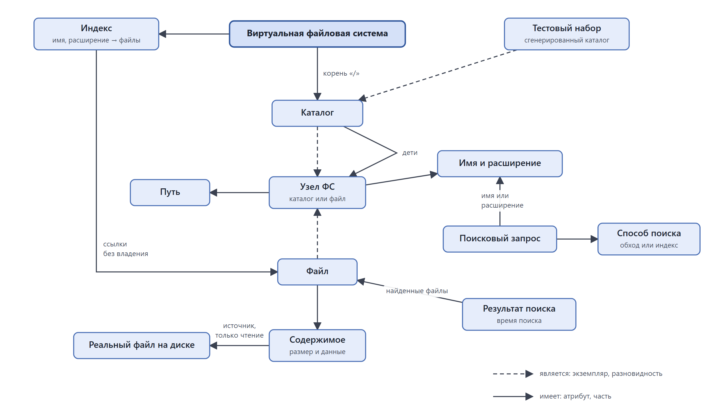
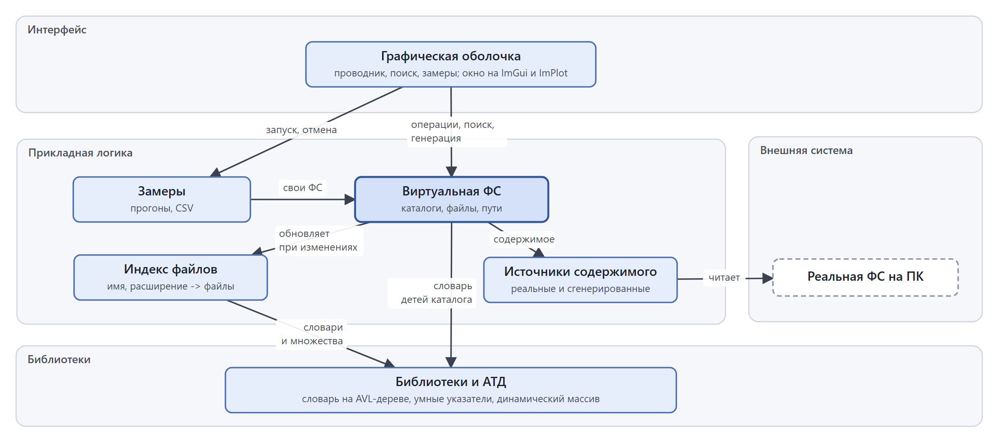

# Дизайн: ЛР-2 «Виртуальная файловая система»

## 1. Постановка задачи

### 1.1. Что делается

Виртуальная файловая система (ВФС) — иерархия каталогов, которая существует только в оперативной
памяти и строится поверх файлов реальной файловой системы. Работа с реальными файлами устроена так:
- файл появляется в ВФС, когда к ней прикрепляют существующий реальный файл;
- удаление, перемещение и переименование меняют только ВФС, реальный файл остаётся на месте и не
  меняется;
- можно импортировать целую реальную папку со всеми подкаталогами.

Файлы ищутся по имени или по расширению двумя способами: полным обходом дерева каталогов и по
индексу, который поддерживается при каждом изменении ВФС. Время обоих способов сравнивается.

Управление идёт через графическую оболочку с тремя вкладками:
- проводник;
- поиск;
- замеры: построение индекса и поиск на объёмах до миллионов файлов.

Выбранные пункты задания: И-12 (ВФС с управляющей оболочкой), И-12.2 (поиск с построением
индексов), М-3 с М-3.1 (AVL-дерево из ЛР-1), О-1.2 (итератор дерева),
словарь на бинарном дереве.

### 1.2. Зачем это нужно

Общий класс задач — организация и поиск файлов без изменения их физического расположения:
- менеджеры медиатеки и документов, где один и тот же файл раскладывается по своим «папкам»;
- виртуальные представления проектов в средах разработки;
- архивы и каталоги резервных копий, где структура хранится отдельно от данных;
- поисковые индексы файловых систем, когда полный обход диска слишком медленный.

Работа также служит основой для семестровой задачи И-14 (прототип файловой системы): там содержимое
файлов будет лежать в секторах, а дерево каталогов и индексы останутся теми же.

## 2. Сущности прикладной задачи

### 2.1. Сущности

| Сущность | Описание |
|---|---|
| Виртуальная файловая система | Дерево каталогов и файлов в памяти с единственным корнем `/`. Отвечает за то, чтобы дерево и индекс не расходились |
| Узел ФС | Общее у каталога и файла: имя, родительский каталог и путь от корня |
| Каталог | Содержит файлы и другие каталоги. Корневой каталог нельзя удалить, переместить или переименовать |
| Файл | Имеет имя и содержимое. В ВФС создаётся только прикреплением реального файла или генератором тестовых данных |
| Имя и расширение | Имя непустое, без `/`, не `.` и не `..`, уникально внутри своего каталога; сравнивается с учётом регистра. Расширение — часть имени после последней точки (у имени вида `.gitignore` расширения нет); сравнивается без учёта регистра и без точки |
| Путь | Строка вида `/docs/report.pdf`, которая однозначно задаёт каталог или файл |
| Содержимое | Размер файла и его данные. Данные могут оказаться недоступны, если реальный файл удалили снаружи |
| Реальный файл на диске | Источник содержимого. Только читается: ВФС никогда не пишет в него, не перемещает и не удаляет |
| Индекс | Соответствия «имя → файлы» и «расширение → файлы» для всей ВФС |
| Поисковый запрос | Что ищется (имя или расширение) и значение |
| Способ поиска | Полный обход дерева каталогов или обращение к индексу |
| Результат поиска | Найденные файлы и время, которое заняли поиски |
| Тестовый набор | Сгенерированный каталог с заданным числом подкаталогов и файлов без реальных данных |
| Замер | Время построения индекса, время поиска обоими способами и память индекса при n файлах |

### 2.2. Связи

На схеме связи двух видов, у каждого вида свой стиль линии:
- пунктир — **является**: сущность служит экземпляром или разновидностью другой;
- сплошная — **имеет**: вторая сущность служит атрибутом или частью первой.

Связи «является»:
- каталог и файл — разновидности узла ФС;
- тестовый набор — обычный каталог, только сгенерированный.

Связи «имеет»:
- ВФС имеет корневой каталог `/` и индекс;
- каталог имеет детей — узлы ФС. У каждого узла, кроме корня, ровно один родительский каталог;
- узел имеет имя с расширением и путь, по которому он находится от корня;
- файл имеет содержимое, у содержимого есть источник — реальный файл, который только читается;
- индекс имеет ссылки на файлы, но не владеет ими: файлом владеет только его каталог;
- поисковый запрос имеет искомое имя или расширение и способ поиска;
- результат поиска имеет найденные файлы.

Выполнение запроса, поддержка индекса в согласии с деревом и замер, который сравнивает два способа
поиска, — это действия, а не устройство данных. Они показаны на схеме архитектуры, а здесь не
нарисованы.

## 3. Архитектура

### 3.1. Компоненты

| Компонент | Слой | Назначение |
|---|---|---|
| Графическая оболочка | интерфейс | Окно на ImGui и ImPlot: проводник, поиск, генератор тестовых данных, вкладка замеров |
| Виртуальная ФС | прикладная логика | Дерево каталогов и файлов, операции по путям, поиск обходом |
| Индекс файлов | прикладная логика | Поиск по имени и расширению; меняется только операциями ВФС |
| Источники содержимого | прикладная логика | Откуда файл берёт данные: реальный файл или сгенерированные данные |
| Замеры | прикладная логика | Построение отдельных ВФС и индексов на n файлах, прогоны, CSV |
| Библиотеки и АТД | библиотека (своя) | Словарь на AVL-дереве из ЛР-1, умные указатели из ДЗ-1, динамический массив, интерфейсы коллекции и перебора |
| Реальная ФС | внешняя система | Файлы и папки на диске, только чтение |

### 3.2. Связи между компонентами

Каждая стрелка означает «вызывает»: подпись говорит, зачем. Модульные тесты и консольная программа
замеров на схеме не показаны: это способы проверить систему, а не её части.

Оболочка меняет ВФС только через её операции. Индекс меняется только из операций ВФС, поэтому не может
разойтись с деревом. Замеры строят собственные ВФС и не трогают ту, что открыта в проводнике.
К реальной ФС обращаются только источники содержимого и импорт папки, и только на чтение.

### 3.3. Описание компонентов, алгоритмов и решений

**Виртуальная ФС**

Каталог хранит детей в словаре «имя → элемент». Отсюда:
- имя уникально в каталоге автоматически;
- поиск ребёнка занимает O(log m), где m — число детей;
- содержимое выводится по алфавиту обходом словаря по ключам, без сортировки.

Каждый элемент знает свой родительский каталог через невладеющую ссылку. По ней строится полный путь
и проверяется, что каталог не переносят внутрь самого себя. Владеет элементом только родитель, поэтому
цикла владения нет, а удалённое поддерево освобождается само.

| Операция | Алгоритм | Сложность |
|---|---|---|
| Найти элемент по пути | Путь делится по `/`, на каждом уровне ребёнок ищется в словаре каталога | O(d · log m) |
| Создать каталог, прикрепить файл | Найти каталог-родитель, проверить имя, добавить ребёнка, добавить файл в индекс | O(d · log m + log n) |
| Импорт папки | Каталог собирается целиком отдельно и прикрепляется в конце. При ошибке чтения ВФС не меняется | O(размер папки) |
| Удалить | Файлы поддерева убираются из индекса, затем поддерево отцепляется от родителя | O(d · log m + k · log n) |
| Переместить | Подъём от целевого каталога к корню: если по пути встретился сам переносимый каталог, это ошибка. Индекс не меняется: он хранит файлы, а не пути | O(d · log m) |
| Переименовать | Ключ в словаре родителя меняется. Если это файл, он переносится в индексе со старого имени на новое | O(d · log m + log n) |
| Поиск обходом | Обход всех каталогов с проверкой каждого файла | O(n) |

Обозначения: n — число файлов в ВФС, d — глубина пути, m — число детей в каталоге, k — число файлов в
удаляемом поддереве.

Решения:
- **Строгая гарантия.** Все проверки (имя, существование, занятость, перенос в себя) выполняются до
  первого изменения. Если операция отклонена, ВФС осталась прежней.
- **Корень особый.** Удалить, переместить или переименовать его нельзя.

**Индекс файлов**

- Два словаря: «имя → множество файлов» и «расширение → множество файлов». Расширение приводится к
  нижнему регистру и записывается без точки.
- Множество файлов — AVL-дерево, упорядоченное по номеру, который файл получает при создании. Поэтому одинаковые имена в разных каталогах не мешают друг другу, а результат
  поиска выдаётся в порядке появления файлов.
- Индекс ссылается на файлы невладеющими ссылками: удалённый файл не продолжит жить из-за индекса.
- Поиск: O(log n + k), где k — число найденных файлов. Каждая операция ВФС обновляет индекс за
  O(log n) на файл, отдельно строить индекс не нужно.

**Источники содержимого**

Файл обращается к данным через общий интерфейс: размер, начало данных, место хранения. Видов два:
- **реальный файл** — читается с диска по абсолютному пути;
- **сгенерированный** — данных нет, используется генератором и замерами.

Новый вид источника, например секторы для И-14, добавляется без изменения ВФС, индекса и оболочки.
Если реальный файл удалили снаружи, элемент остаётся в ВФС, а размер показывается как недоступный.

**Замеры**

- Для n от 10³ до заданного максимума с шагом 1-2-5 строятся отдельные ВФС.
- Время построения индекса замеряется для трёх порядков добавления файлов: имена по возрастанию, по
  убыванию и вразнобой. Это три случая из задания.
- Замеряется время одного поиска по имени обоими способами и память индекса.
- Результаты сохраняются в CSV. Оболочка открывает файлы, посчитанные консольной программой.

**Графическая оболочка**

- Проводник:
  - дерево каталогов, таблица содержимого, путь в виде «хлебных крошек», панель просмотра файла;
  - перемещение перетаскиванием на каталог, на строку `..` или на элемент пути;
  - контекстное меню: открыть, переименовать, удалить, создать каталог.
- Таблица рисует только видимые строки, поэтому каталог на 10⁵ файлов прокручивается без задержек.
- Дерево каталогов запрашивает детей только у раскрытых узлов.
- Своё окно выбора реального файла или папки: выбор диска, переход к родительской папке, ввод пути.
- Замеры идут в фоновом потоке и могут быть остановлены.
- Ошибка любой операции показывается сообщением, программа продолжает работу.
- Имена и пути хранятся в UTF-8, поэтому кириллица работает в именах ВФС и в путях реальных файлов.

## 4. Функциональные требования

**К файлу**
- ФТ-1. Прикрепить реальный файл к каталогу ВФС, при желании под другим именем. Если реального файла
  нет или по пути лежит не файл, это ошибка.
- ФТ-2. Показать файл: размер, место хранения данных и первые 4 КБ текстом или шестнадцатеричным
  дампом. Если реальный файл удалён снаружи, вместо размера показывается «нет доступа».
- ФТ-3. Переместить, переименовать, удалить файл. Реальный файл при этом не меняется.

**К каталогу**
- ФТ-4. Создать каталог по пути. Родитель должен существовать, имя — быть допустимым и свободным.
- ФТ-5. Импортировать реальную папку со всеми подкаталогами как новый каталог.
- ФТ-6. Показать содержимое: сначала каталоги, потом файлы, внутри каждой группы по алфавиту.
- ФТ-7. Удалить каталог со всем содержимым; переместить его. Каталог нельзя переместить внутрь самого
  себя или своего потомка.
- ФТ-8. Переименовать каталог. В целевом каталоге не должно быть элемента с тем же именем — это
  правило действует и для перемещения.

**К файловой системе в целом**
- ФТ-9. Корень нельзя удалить, переместить или переименовать.
- ФТ-10. При ошибке операции выдаётся понятное сообщение, а ВФС остаётся в прежнем состоянии.
- ФТ-11. Реальные файлы только читаются: ни одна операция не пишет в них, не перемещает и не удаляет их.
- ФТ-12. Сгенерировать тестовый каталог с заданным числом подкаталогов и файлов. Если имя
  `/generated` занято, берётся `/generated_2` и так далее. Расширения чередуются: txt, log, pdf, png,
  md. Показать время генерации.

**К поиску**
- ФТ-13. Найти файлы по точному имени или по расширению во всей ВФС двумя способами: полным обходом и
  по индексу.
- ФТ-14. Индекс обновляется каждой операцией ФТ-1 и ФТ-3…ФТ-8, отдельно строить его не нужно. После
  любой операции оба способа находят одни и те же файлы.
- ФТ-15. Показать найденные файлы, время каждого способа и во сколько раз индекс быстрее. Двойной щелчок
  по результату открывает файл в проводнике.

**К замерам**
- ФТ-16. Для n от 10³ до заданного максимума с шагом 1-2-5 замерить:
  - время построения индекса при именах по возрастанию, по убыванию и вразнобой;
  - время поиска обоими способами;
  - память индекса.
- ФТ-17. Показать результаты графиками в логарифмическом масштабе и таблицей, время построения — в мс
  или в нс на файл.
- ФТ-18. Сохранить результаты в CSV и загрузить сохранённые. Остановить замер, не дожидаясь конца.
- ФТ-19. Консольная программа замеров с параметрами: максимальное n, начальное значение генератора,
  файл результата.

**К оболочке**
- ФТ-20. Проводник:
  - дерево каталогов;
  - таблица содержимого;
  - путь в виде «хлебных крошек»;
  - панель просмотра.
- ФТ-21. Перемещение перетаскиванием на каталог, на строку `..` или на элемент пути.
- ФТ-22. Контекстное меню элемента: открыть, переименовать, удалить. Контекстное меню пустого места:
  создать каталог.
- ФТ-23. Окно выбора реального файла или папки: выбор диска (на Windows), переход в родительскую
  папку, ввод пути.

**Вне рамок работы**

Права доступа (И-12.1), запись в файлы, сохранение ВФС между запусками, поиск по префиксу и маске,
секторы (И-14).
