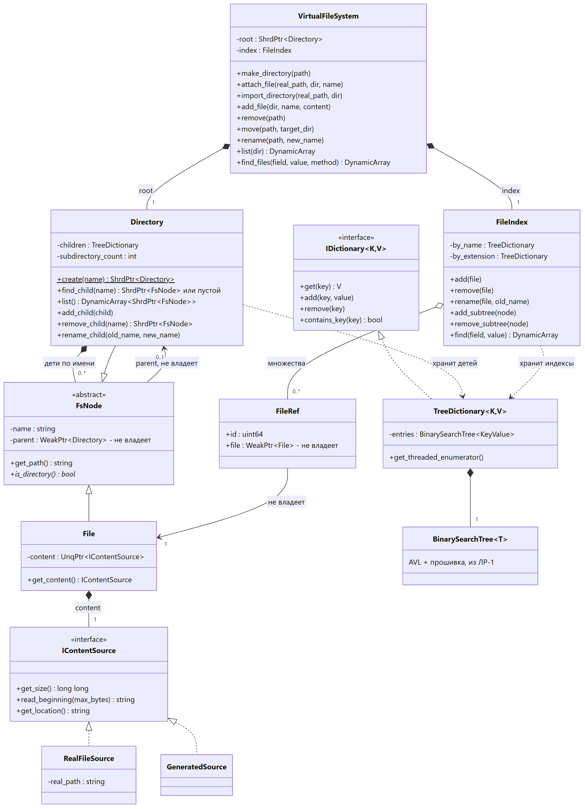
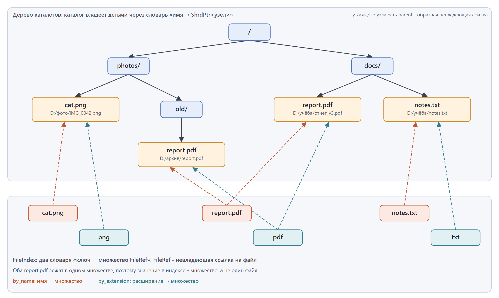
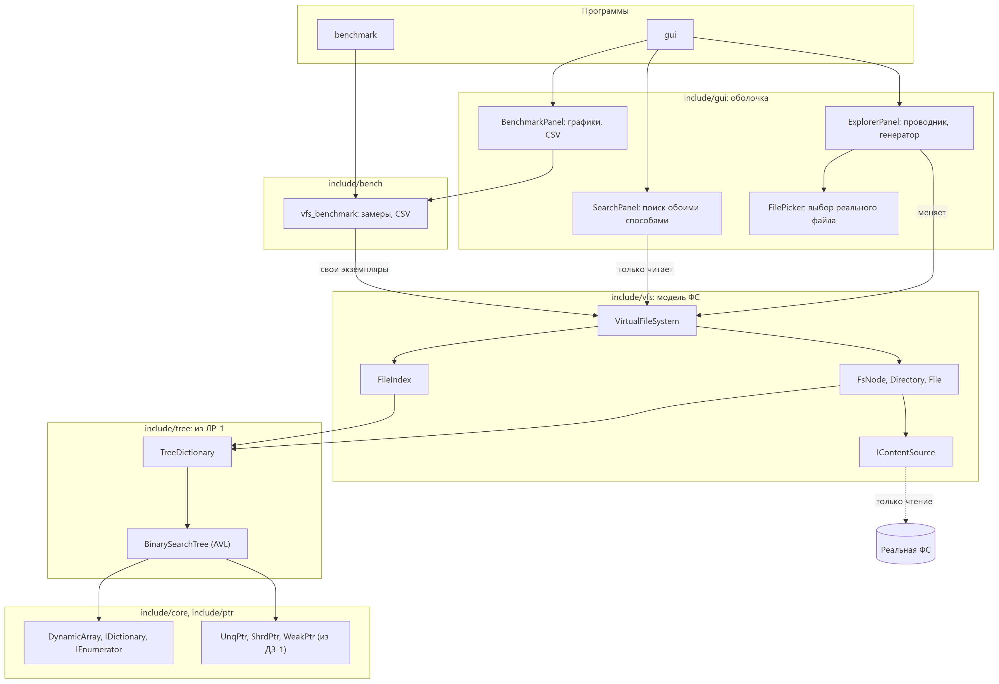

# ТЗ: ЛР-2 «Виртуальная файловая система»

## 1. Назначение

Программа строит в оперативной памяти иерархию каталогов поверх файлов реальной файловой системы.
Файлы в ней ищутся двумя способами, полным обходом и по индексу, и время этих способов сравнивается.
Реальные файлы никуда не перемещаются и не изменяются: виртуальная ФС хранит только ссылки на них.
Управление идёт через графическую оболочку с тремя вкладками: проводник, поиск, бенчмарк.

## 2. Выбранные пункты и рейтинг

| Пункт | Что делается | Рейтинг |
|---|---|---|
| И-12 | Виртуальная файловая система с управляющей оболочкой | 20 |
| И-12.2 | Поиск файлов с построением индексов | 15 |
| М-3 | Бинарное дерево поиска (из ЛР-1) | 15 |
| М-3.1 | Сбалансированное (AVL) | 7 |
| М-3.2 | Прошитое: вывод каталога по алфавиту по нитям | 7 |
| О-1.2 | Итератор бинарного дерева | 4 |
| IDictionary / бинарное дерево | Словарь на AVL: содержимое каталогов и индексы | 5 |
| | **Итого** | **73** (нужно ≥ 55) |

## 3. Сущности

| Сущность | Класс | Что это и за что отвечает |
|---|---|---|
| Виртуальная ФС | `VirtualFileSystem` | Точка входа: операции над деревом по путям и поиск. Следит, чтобы дерево и индекс не расходились |
| Узел | `FsNode` (абстрактный) | Общее у каталога и файла: имя, родитель, полный путь |
| Каталог | `Directory` | Узел с детьми. Корень - каталог `/` |
| Файл | `File` | Узел-лист: виртуальное имя и источник содержимого |
| Источник содержимого | `IContentSource` | Откуда файл берёт данные: размер, первые байты и место, где лежат данные |
| Реальный файл | `RealFileSource` | Источник - файл на диске по абсолютному пути, только для чтения |
| Сгенерированный файл | `GeneratedSource` | Источник без данных для генератора и бенчмарка, диск не трогает |
| Индекс | `FileIndex` | Два словаря: «имя -> множество файлов» и «расширение -> множество файлов» |
| Ссылка на файл | `FileRef` | Невладеющий указатель на файл, элемент множества в индексе |
| Словарь | `IDictionary` / `TreeDictionary` | Интерфейс «ключ -> значение» и его реализация на AVL-дереве |
| AVL-дерево | `BinarySearchTree` | Сбалансированное прошитое дерево из ЛР-1, в нём хранятся словари и множества |
| Путь | строка | Абсолютный путь через `/`, например `/docs/report.pdf`. Однозначно задаёт узел |
| Результат замера | `bench::SizeResult` | Время построения индекса и поиска, память индекса для одного размера n |

Ограничения на имя:
- непустое;
- без `/`;
- не `.` и не `..`;
- уникально внутри своего каталога.

Имена сравниваются с учётом регистра. Расширения сравниваются без учёта регистра латиницы и без точки: у файла `Report.PDF` и у запроса `.pdf` расширение одно и то же, `pdf`.

## 4. Связи между сущностями

Как это выглядит в памяти на примере:

| Связь | Вид, кратность | Смысл |
|---|---|---|
| ВФС -> корневой каталог | композиция, 1 : 1 | ВФС владеет всем деревом: при удалении ВФС освобождаются все узлы |
| ВФС -> индекс | композиция, 1 : 1 | Индекс принадлежит ВФС и меняется только её операциями, поэтому всегда совпадает с деревом |
| Каталог -> дети | композиция через `ShrdPtr`, 1 : 0..* | Каталог владеет детьми через словарь «имя -> узел». Имя служит ключом, поэтому оно уникально в каталоге, а дети выводятся по алфавиту. Вместе с каталогом удаляется всё его поддерево |
| Узел -> родитель | ассоциация через `WeakPtr`, 0..1 (у корня родителя нет) | Обратная невладеющая ссылка. По ней строится полный путь и проверяется, что каталог не перемещают внутрь самого себя. Она не владеет родителем, чтобы не возник цикл владения |
| Каталог, Файл -> Узел | наследование | Каталог хранит детей одним типом и не различает файлы и каталоги (паттерн «компоновщик») |
| Файл -> источник содержимого | композиция, 1 : 1 | Файл обращается к данным только через интерфейс, поэтому новый вид источника не требует менять остальной код. В И-14 добавятся секторы |
| Реальный файл -> файл на диске | ассоциация по пути, только чтение | ВФС никогда не пишет на диск. Если файл удалили снаружи, узел остаётся, а его данные показываются как недоступные |
| Индекс -> файлы | агрегация через `FileRef` (номер файла и `WeakPtr`), 1 : 0..* | Индекс ссылается на файлы, но не владеет ими. Каждый файл лежит ровно в двух множествах: по имени и по расширению |
| `TreeDictionary` -> `IDictionary` | реализация интерфейса | Каталоги и индекс пользуются операциями словаря и не зависят от устройства дерева |
| `TreeDictionary` -> AVL-дерево | композиция | Пары «ключ-значение» лежат в AVL-дереве в порядке ключей. Отсюда O(log n) на операцию и обход по алфавиту по нитям |
| Проводник -> ВФС | использует и меняет | Все изменения дерева идут через операции ВФС |
| Поиск -> ВФС | использует, только чтение | Запускает оба алгоритма поиска на текущем дереве |
| Бенчмарк -> ВФС, индекс | создаёт свои | Для замера строятся отдельные ВФС и индексы, открытая в проводнике ВФС не меняется |

Инварианты, которые поддерживают эти связи:

- имя узла совпадает с его ключом в словаре родителя, поэтому имя и родителя меняет только каталог;
- у каждого узла, кроме корня, ровно один родитель, и этот родитель действительно содержит узел;
- после любой операции поиск по индексу возвращает то же множество файлов, что и полный обход.

Модули: стрелка означает «использует».

## 5. Функциональные требования

**Операции над ФС.** При ошибке бросается исключение с понятным сообщением, а ФС не меняется.

- ФТ-1. Создать каталог по пути. Родитель должен существовать, имя должно быть допустимым и свободным.
- ФТ-2. Прикрепить реальный файл к виртуальному каталогу, при желании под другим именем.
  Если реального файла нет или по пути лежит не файл, это ошибка.
- ФТ-3. Импортировать реальную папку целиком, с подкаталогами, как новый каталог.
- ФТ-4. Удалить файл или каталог со всем содержимым. Удаление только из ВФС, реальные файлы остаются на месте.
- ФТ-5. Переместить узел в другой каталог. Каталог нельзя переместить внутрь самого себя
  или своего потомка, и в целевом каталоге не должно быть узла с тем же именем.
- ФТ-6. Переименовать узел.
- ФТ-7. Корень нельзя удалить, переместить или переименовать.
- ФТ-8. Показать содержимое каталога: сначала каталоги, потом файлы, внутри каждой группы по алфавиту
  (обход по нитям прошивки).
- ФТ-9. Показать файл: размер, место, где лежат данные, и первые 4 КБ текстом или
  шестнадцатеричным дампом. Если реальный файл удалён снаружи, вместо размера выводится «нет доступа».

**Поиск**

- ФТ-10. Найти файлы по точному имени или по расширению во всей ВФС.
- ФТ-11. Поиск выполняется двумя алгоритмами: полным обходом дерева и по индексу. Индекс обновляется
  каждой операцией ФТ-1…ФТ-6, отдельно строить его не нужно.
- ФТ-12. Показать найденные файлы, время каждого алгоритма и во сколько раз индекс быстрее.
  Двойной щелчок по результату открывает файл в проводнике.

**Генератор тестовых данных**

- ФТ-13. Создать каталог `/generated` (если имя занято, то `/generated_2` и т.д.) с заданным числом
  подкаталогов и файлов. Расширения файлов чередуются: txt, log, pdf, png, md. После генерации
  показать, сколько она заняла времени.

**Бенчмарк**

- ФТ-14. Для n от 10³ до 10^k с шагом 1-2-5 замерить:
  - время построения индекса, если файлы добавляются с именами по возрастанию, по убыванию и вразнобой;
  - время одного поиска по имени полным обходом и по индексу;
  - память индекса.
- ФТ-15. Показать результаты графиками в логарифмическом масштабе по обеим осям и таблицей.
  Время построения выводится в мс или в нс на один файл.
- ФТ-16. Сохранить результаты в CSV и загрузить ранее сохранённые.
- ФТ-17. Остановить замер, не дожидаясь конца.
- ФТ-18. Консольная программа `benchmark` с параметрами `--max N`, `--seed` и `--out` для больших n.
  Её CSV открывается в GUI.

**Оболочка (GUI)**

- ФТ-19. Проводник: дерево каталогов, таблица содержимого, «хлебные крошки» пути и панель просмотра.
- ФТ-20. Перетаскивание узла на каталог, на строку `..` или на элемент «хлебных крошек» перемещает узел (ФТ-5).
- ФТ-21. Контекстное меню узла: открыть, переименовать, удалить. На пустом месте контекстное меню
  предлагает создать каталог.
- ФТ-22. Своё окно выбора реального файла или папки: выбор диска (на Windows), переход в
  родительскую папку, ввод пути.
- ФТ-23. Ошибка операции выводится сообщением в окне, программа продолжает работу.

## 6. Нефункциональные требования

**Сложность операций**

Обозначения:
- n - число файлов в ВФС;
- k - число найденных файлов;
- d - глубина пути;
- m - число детей в каталоге.

| Операция | Сложность |
|---|---|
| Поиск по индексу | O(log n + k) |
| Поиск полным обходом | O(n) |
| Найти узел по пути | O(d · log m) |
| Добавить, удалить или переименовать файл с обновлением индекса | O(d · log m + log n) |
| Получить содержимое каталога | O(m) |

**Производительность**

Измерено при n = 10⁶, данные в `benchmarks/results.csv`:

- поиск по индексу занимает около 1,8 мкс, полный обход около 165 мс, то есть разница примерно в 10⁵ раз;
- построение индекса занимает около 0,8 с при именах по возрастанию, около 0,7 с по убыванию и около 3,3 с вразнобой.
  Скорее всего, дело в промахах кэша: при последовательных именах каждая вставка проходит почти
  тем же путём по дереву, что и предыдущая. Высота дерева от порядка имён не зависит: AVL сбалансировано в любом случае;
- индекс занимает около 500 МБ, то есть около 530 байт на файл (`FileRef` с `WeakPtr` — 24 байта вместо 8, узел дерева на `ShrdPtr` тоже вдвое крупнее).

**Отзывчивость интерфейса**

- каталог на 10⁵ файлов прокручивается без задержек, потому что рисуются только видимые строки;
- дерево каталогов запрашивает детей только у раскрытых узлов, а проверка «есть ли подкаталоги» выполняется за O(1);
- бенчмарк работает в фоновом потоке, поэтому окно во время замера не зависает.

**Надёжность**

- строгая гарантия исключений: при ошибке ФС остаётся в прежнем состоянии;
- реальные файлы только читаются, ВФС никогда не пишет в них, не перемещает и не удаляет их;
- пути и имена хранятся в UTF-8, кириллица работает и в именах, и в путях реальных файлов.

**Переносимость и сборка**

- C++17;
- один Makefile для Windows (MinGW, `mingw32-make`) и Linux (g++, `make`);
- цели сборки: `unit_tests`, `benchmark`, `gui`; на Windows исполняемые файлы собираются статически.

**Ограничения реализации**

- используются свои умные указатели `UnqPtr`/`ShrdPtr`/`WeakPtr` из ДЗ-1; сырых указателей на узлы нет, а в модели ФС свои `DynamicArray` и `TreeDictionary`;
- заголовочные файлы не используют потоки ввода-вывода (`std::ostream` и т.п.);
- из ЛР-1 переиспользуются AVL-дерево с прошивкой и перечислителями, каркас GUI (ImGui + ImPlot),
  бенчмарк и работа с CSV.

**Расширяемость.** Новый вид источника содержимого (секторы в адресном пространстве для И-14)
добавляется наследником `IContentSource`, без изменений в ВФС, индексе и GUI.

**Тестирование (GoogleTest)**

- проверяются все операции ФТ-1…ФТ-9 вместе с граничными случаями:
  - занятое имя;
  - недопустимое имя;
  - перемещение каталога внутрь самого себя;
  - удаление корня;
  - несуществующий путь;
  - кириллица в именах;
- после удаления, перемещения и переименования реальные файлы остаются на месте без изменений;
- после случайной последовательности операций поиск по индексу даёт тот же результат, что полный обход;
- `TreeDictionary` сверяется с `std::map` на случайных операциях;
- бенчмарк заполняет все значения, а CSV сохраняется и читается без потерь.

## 7. Вне рамок

В работу не входят:
- права доступа (И-12.1);
- запись в файлы;
- сохранение самой ВФС между запусками;
- поиск по префиксу и маске;
- секторы и `Stream<char>` (это семестровая задача И-14).
